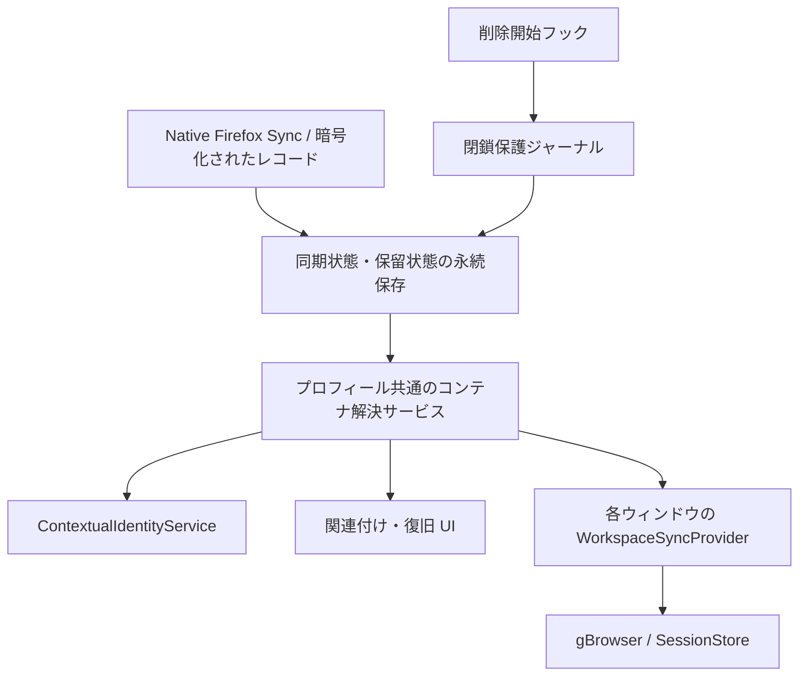

# ワークスペース同期のコンテナ対応 — 設計書

作成日: 2026-10-28（日本時間）

状態: 実装に合わせた設計。native 移行・削除 lifecycle
の先行実証済み。最終統合・実アカウント QA は継続中。

関連文書: [仕様書](specification.md) / [実装計画書](implementation-plan.md)

## 1. 設計の前提

ワークスペース・タブが参照する論理コンテナを、各プロフィールのローカルコンテナに対応付ける。
同期するのは識別情報・作成用メタデータ・所属関係であり、Cookie
や認証状態ではない。
以下のコレクション名・ファイル名は実装と対応する。型の抜粋は説明用であり、正本は共通モデルと
wire parser にある。 仕様書 FR-01〜FR-14
を満たすことを優先し、方式の変更時も受け入れ条件を維持する。

## 2. 現行実装と変更が必要な理由

Floorp の参照版は `c122afebbdbb4627a3d342c5b8d969686024c7e9`。 Runtime は、その
`floorp-runtime.lock.json` が指定する
`0ac255739cdd64e100cd6913329247421b0ec2ea`（Gecko 159）を参照した。
このベースから分離した作業 checkout に製品コードと Runtime patch
を実装している。

| 現行の根拠                                                                                                                                                                                                | 確認できる動作                                                                                            | 設計への影響                                                                   |
| --------------------------------------------------------------------------------------------------------------------------------------------------------------------------------------------------------- | --------------------------------------------------------------------------------------------------------- | ------------------------------------------------------------------------------ |
| [同期 ADR v1](https://github.com/Floorp-Projects/Floorp/blob/c122afebbdbb4627a3d342c5b8d969686024c7e9/docs/development/workspace-sync/ADR-001-workspace-tab-sync.md)                                      | Cookie・コンテナ番号は同期対象外。ワークスペースとタブは別レコード                                        | コンテナ定義・参照を新たに設計する                                             |
| [workspacesSync.ts](https://github.com/Floorp-Projects/Floorp/blob/c122afebbdbb4627a3d342c5b8d969686024c7e9/browser-features/chrome/common/workspaces/workspacesSync.ts#L579)                             | 受信先の既定コンテナ番号で `gBrowser.addTab` する                                                         | 受信対象ごとの解決をタブ生成より前に行う                                       |
| [workspace-sync.ts](https://github.com/Floorp-Projects/Floorp/blob/c122afebbdbb4627a3d342c5b8d969686024c7e9/browser-features/modules/common/workspace-sync.ts)                                            | version 1 を検証し、既知フィールドで再構築。観測から消えたタブを削除扱いにする                            | 任意フィールド追加だけでは旧版互換にならない。保留・保護タブを欠落扱いにしない |
| [FloorpWorkspacesSync.sys.mts](https://github.com/Floorp-Projects/Floorp/blob/c122afebbdbb4627a3d342c5b8d969686024c7e9/browser-features/modules/modules/workspaces/FloorpWorkspacesSync.sys.mts)          | `captureNow`、保留適用・基準スナップショット、アカウント epoch を管理                                     | 新しい状態を既存の差分・再試行・アカウント境界へ統合する                       |
| [Runtime の削除 UI](https://github.com/Floorp-Projects/Floorp-Runtime/blob/0ac255739cdd64e100cd6913329247421b0ec2ea/browser/components/preferences/config/containers.mjs#L124)                            | `closeContainerTabs` の後に `remove` を実行する                                                           | 削除後通知だけでは TabClose の保護が間に合わない                               |
| [ContextualIdentityService](https://github.com/Floorp-Projects/Floorp-Runtime/blob/0ac255739cdd64e100cd6913329247421b0ec2ea/toolkit/components/contextualidentity/ContextualIdentityService.sys.mjs#L552) | `remove` はサイトデータ削除後に deleted 通知を出す                                                        | 事前保護と削除後の無効化を分ける                                               |
| [Native SyncEngine](https://github.com/Floorp-Projects/Floorp-Runtime/blob/0ac255739cdd64e100cd6913329247421b0ec2ea/services/sync/modules/engines.sys.mjs#L1149)                                          | サーバーより大きい engine version は reset 経路、古いクライアントは拒否。resetSyncID は wipeServer を伴う | 単純な version 引き上げで移行しない                                            |

## 3. 不変条件

1. 未解決の参照を「コンテナなし」と解釈しない。正しいコンテナが決まるまで対象
   URL を読み込まない。
2. ローカルの数値 ID を同期ペイロードへ入れない。対応表も端末間では同期しない。
3. 受信した情報・未展開タブ・保護された閉鎖を、ブラウザー上にないという理由で削除しない。
4. コンテナ削除と明示的なタブ置換は、通常のタブ閉鎖と別の原因として記録する。
5. 他端末からの正当なタブ削除は保護状態より優先する。閉じられた UUID
   を復旧で復活させない。
6. 関連付け変更で Cookie を操作しない。ユーザー自身のコンテナ削除は native
   の既存動作に従う。
7. ユーザーの関連付け操作を待つ間も、同期通信全体を待機させない。
8. アカウント切替、機能無効化、ウィンドウ終了をまたぐ非同期処理は適用前に再検証する。

## 4. 構成と責務



| 要素                          | 責務                                                                  |
| ----------------------------- | --------------------------------------------------------------------- |
| 共通モデル・wire parser       | UUID・メタデータ・コンテナ参照・clock の検証、マージ                  |
| プロフィール共通 ESM サービス | 関連付け、作成排他、永続保留、削除保護、アカウント境界                |
| Chrome adapter                | 実コンテナの観測、生成前の解決、タブ置換、SessionStore の論理 ID 管理 |
| 復旧 UI                       | 初回確認、複数候補選択、削除後の再関連付け／作成／同期解除            |
| Runtime フック                | タブが閉じられる前に原因と影響範囲を捕捉する                          |

ウィンドウごとに対応表やダイアログ要求を持たず、共通サービスから状態を購読する。
既存の同期表示に「関連付け待ち」等を追加し、通信エラーと区別する。

## 5. データモデル

### 5.1 同期する情報

```ts
type ContainerRef =
  | { kind: "none" }
  | { kind: "container"; containerId: string }
  | { kind: "legacy-unresolved" };

interface SyncedContainerDefinition {
  version: 2;
  kind: "container";
  containerId: string; // UUID。BSO の ID と一致させる
  name: string;
  color: string;
  icon: string;
  modifiedAt: number;
  modifiedBy: string;
}
```

- ワークスペースの metadata に `defaultContainer: ContainerRef` を追加する。
- タブに `container: ContainerRef`
  を追加し、作成・観測時の実コンテナを記録する。
- `none` は明示的な通常コンテナ。省略・不正値・参照先未受信とは区別する。
- `legacy-unresolved` は v1
  移行専用。旧データに所属情報がないことを表し、新規タブからは生成しない。
- ワークスペースの既定変更は将来の新規タブへ適用する。既存タブの参照を一括で書き換えない。
- コンテナ定義・ワークスペース・タブは別 BSO。既存と同じ native CryptoWrapper
  を使う。
- 親や定義より先にタブが到着しても保存し、必要な参照が揃うまで展開を保留する。

既存の HTTP(S) 制約・Unicode 検証・1 entity あたり 16 KiB 上限を維持する。
名前は既存ワークスペースと同じく最大 256 UTF-16 code units とする。
色・アイコンは native
が扱える値を検証し、非対応値の場合は作成せず理由を表示する。 任意
URL・任意ファイル・実行可能なアイコン指定は扱わない。

定義とワークスペース metadata、各タブは、それぞれ既存同様の clock
と決定的な比較でマージする。
タブ単位の競合規則を無断でフィールド単位に変更しない。
Cookie、サイトデータ、端末のコンテナ番号、アカウント UID は wire へ含めない。

### 5.2 ローカルだけに保存する情報

| 情報               | キー／内容                                                               | 主な用途                           |
| ------------------ | ------------------------------------------------------------------------ | ---------------------------------- |
| 関連付け           | アカウント UID + 論理コンテナ UUID → local instance UUID + userContextId | 端末の実コンテナを選ぶ             |
| 実体レジストリ     | local instance UUID、現在の数値 ID、生成世代、削除記録                   | 数値 ID 再利用を旧実体と誤認しない |
| 関連付け状態       | 未設定、確認待ち、作成中、準備済み、削除済み、作成失敗                   | 初回作成と削除後復旧を区別         |
| 保留適用           | workspaceId、tabId、希望する参照、基準観測、保留理由                     | 未展開を閉鎖として送らない         |
| 作成ジャーナル     | operationId、論理 UUID、開始時の候補実体、結果                           | 二重作成とクラッシュ復旧           |
| 閉鎖保護ジャーナル | operationId、原因、対象の実体世代・タブ UUID、前後の状態                 | native 閉鎖と通常閉鎖を区別        |
| 明示適用ジャーナル | 置換元・置換先、論理 tabId、段階                                         | 失敗時に元の作業と同期 ID を維持   |

同期状態は `floorp-workspaces-sync-v2.json`、対応表は
`floorp-workspace-container-bindings.json`、 移行ジャーナルは
`floorp-workspaces-migration.json` に分けてプロフィール内へ保存する。
対応表と移行ジャーナルは一時ファイルを使う `IOUtils.writeJSON`、
同期状態の破壊的操作前は保存後の再読み込み照合で永続化を確認する。
別ファイル間に原子性があるとは仮定せず、operationId
による再開可能な段階を記録する。 破壊的操作の前の保存完了は `saveSoon`
呼び出しだけで判定しない。

ローカル実体レジストリはプロフィール単位、同期との関連付けはアカウント単位とする。
サインアウトで実体・Cookie
を消さず、関連付け・保留・旧アカウントの処理権限を無効化する。 複数の論理 UUID
を同じローカルコンテナへ関連付ける場合も、各タブの論理参照を保持する。
逆引きで任意の UUID に置き換えない。新規タブはワークスペースの論理参照を優先し、
それが使えない実コンテナには一つの送信用 UUID を明示的に登録する。

### 5.3 名前・外観の扱い

名前は完全一致を初回候補の条件とする。大文字小文字・空白・Unicode
正規化で自動統合しない。
組み込みコンテナはサービスの表示名を候補名に使う。言語が違えば同名にならない場合がある。
翻訳名の意味を推測した自動統合は初期範囲外とし、後から手動で関連付け可能にする。
既存コンテナの外観は上書きしない。受信メタデータは候補表示と新規作成に使う。
初期実装では、定義の作成用メタデータは初回登録時の値を保持する。
送受信いずれの端末でもローカル表示名変更を wire の更新として送り返さない。
したがって、新しい端末での候補検索・作成には初期の名前が使われる場合がある。
これは仕様書 D-05 の実装上の補足である。外観の双方向編集を追加する場合は、
編集権限・競合・関連付け済み端末への反映を別の設計として扱う。

## 6. 解決処理と状態遷移

| 現在の状態／条件               | 処理                                         | 次の状態          |
| ------------------------------ | -------------------------------------------- | ----------------- |
| `none`                         | local ID 0 を明示的に使用                    | 準備済み          |
| 定義が未到着                   | 保存して定義の受信を待つ                     | 定義待ち          |
| `legacy-unresolved`            | 適用範囲と既存／新規／明示的 none を選択する | 移行設定待ち      |
| 有効な記憶済み対応             | 実体世代とアカウントを検証                   | 準備済み          |
| 初回・同名一件                 | 初回確認を登録                               | 確認待ち          |
| 初回・同名複数                 | 候補選択を登録                               | 確認待ち          |
| 初回・候補なし                 | 排他下で作成・保存                           | 作成中 → 準備済み |
| 作成または保存失敗             | 誤展開せず原因を表示                         | 作成失敗          |
| 記憶済み実体が削除された       | 保護・無効化。初回へ戻さない                 | 削除済み          |
| 削除済みから再関連付け／再作成 | 明示操作で保存                               | 準備済み          |

確認を閉じる操作はキャンセルによる同期削除ではなく、保留の継続とする。
旧データの未確定所属は待つだけでは解決しないため、移行設定 UI を用意する。
ワークスペース既定と対象タブを分けて適用範囲を示し、既存タブの開き直しは明示操作にする。
バックグラウンド受信時に modal
を連続表示せず、状態表示からユーザーが開けるようにする。
一つのプロフィールで同じ論理 UUID の解決・作成を single-flight にする。 異なる
UUID が同名を持つ場合も、候補再検査と作成をプロフィール単位で直列化する。

クラッシュ後に「作成したが対応保存前だった」可能性があれば、operationId
と実体の生成記録を照合する。
証明できなければ自動再作成せず、候補確認へ進む。同名という理由だけで作成成功とみなさない。
実体レジストリと native の作成・削除通知を照合し、失われた実体の数値 ID
を新実体の証拠として再利用しない。

## 7. 受信・観測・既存タブへの適用

### 7.1 受信順序

1. レコードを検証し、同じアカウントの ledger に永続化・マージする。
2. 正常保存できた受信は通信上受領済みにできる。UI
   待ちを通信エラーや再ダウンロードの無限ループにしない。
3. ワークスペースの既定参照を解決し、その端末の既定設定へ反映する。未解決時は新規生成を制御する。
4. 各タブの実参照を解決する。解決済みの無関係なタブまで止める必要はない。
5. `withExplicitTabUserContext` と明示的な `userContextId`
   を使い、最初から正しいコンテナで生成する。
6. 対象 workspaceId、安定 tabId、論理コンテナ参照を SessionStore に保持する。
7. 読み込み完了・失敗処理は既存の navigation intent
   を維持し、適用状態を更新する。

未解決の既定を持つワークスペースでユーザーが通常の新規タブを開く場合も、
「関連付けを設定」を案内し、暗黙のコンテナ 0 で対象 URL を開かない。
明示的な別コンテナ指定と通常コンテナ指定は、仕様どおり別の有効な操作として扱う。

### 7.2 capture の変更

従来の「前回存在し、今回の観測にないなら閉鎖」は、保留中・削除保護中・置換中のタブには適用しない。
観測結果に少なくとも `observed`、`pending-materialization`、`protected-close`、
`pending-reopen` を区別する情報を付ける。 実タブが存在しない対象も、正当な
remote tombstone がない限り希望状態を維持する。
物理順序・基準スナップショットの計算にも同じ分類を使い、欠落による並びの変更を送らない。
保護対象でない通常のタブ閉鎖と、受信した正当な閉鎖は従来どおり処理する。
起動時は SessionStore
復元と実コンテナ照合を終えてから、欠落に基づく削除判定を開始する。

### 7.3 既存タブの論理参照または関連付け先実体が変わる場合

論理 UUID
が同じでも関連付け先実体が変わる場合を含め、既存タブを黙って開き直さない。
希望参照・解決先実体と現在の実参照を分けて `pending-reopen` とする。
この間は旧コンテナの観測で希望参照を上書きしない。 異なるコンテナ向けに届いた新
URL を、現在の旧コンテナで自動ロードすることもしない。
ユーザーが「選択したコンテナで開き直す」を実行したら、操作ジャーナルを保存し、
正しいコンテナで置換先を作成・検証した後に同期上の tabId を引き継ぐ。
置換元の閉鎖は同期削除にせず、途中失敗時は元タブを維持する。 同じ論理 tabId
を二つの実タブから同時に capture しないよう所有権の移行を直列化する。
未送信のフォーム内容や完全なページ状態の移送は保証せず、操作前に開き直しであることを示す。
再起動時に残った置換トークンは完了できる呼び出し元を失っているため無効化する。
希望タブ・保護
UUID・コンテナ保留は残し、古いトークンが通常閉鎖を永久に抑止しないようにする。

## 8. 関連付け先削除の処理

### 8.1 native 経路への介入

削除後の `contextual-identity-deleted` observer だけでは FR-10 を満たさない。
設定 UI
はタブを先に閉じる一方、[拡張の remove API](https://github.com/Floorp-Projects/Floorp-Runtime/blob/0ac255739cdd64e100cd6913329247421b0ec2ea/toolkit/components/extensions/parent/ext-contextualIdentities.js#L327)
は identity の削除へ直接進む。
[コンテナ機能全体の無効化](https://github.com/Floorp-Projects/Floorp-Runtime/blob/0ac255739cdd64e100cd6913329247421b0ec2ea/browser/components/preferences/config/tabs-browsing.mjs#L354)
にも一括閉鎖経路がある。 Runtime の `workspace-container-lifecycle.patch`
はこれらの経路を共通の prepare / guard / finish 通知へ接続する。 prepare の
blocker が保存完了するまで、最初の閉鎖・実体消失へ進めない。
保護対象の未準備な同期 remove は guard
で止める。キャンセル済みの操作トークンは再利用できない。
`ContextualIdentityService.remove` は同期 API なので、削除後 observer から
Promise を返しても
事前保存の待機にはならない。正式な呼び出し経路に、保存完了を待てる事前処理を接続する。
単なる「このコンテナのタブをすべて閉じる」は削除とは区別し、通常の閉鎖として同期する。

### 8.2 操作手順

1. 削除確認後・閉鎖前に、対象実体と参照する全ウィンドウの同期 tabId を確定する。
   最新のローカル観測も保存し、まだ送信していない URL
   変更や新規タブを古い状態で保護しない。
2. 共通キュー内で `deleting` と保護対象を記録し、永続保存の完了を待つ。
3. 対象実体への新規タブ生成・関連付け適用を止め、既に走る処理にも
   cancellation/generation を伝える。
4. native の削除を実行する。保護対象の TabClose は通常の tombstone
   生成から除外する。
5. 削除通知で関連付けを `deleted` に確定する。複数 UUID
   が同じ実体を使う場合は全対応を無効化する。
6. 他端末のレコードを変更せず、ローカル UI
   に再関連付け・再作成・同期解除を表示する。
7. 復旧時は最新の ledger を再評価する。途中で remote が閉じたタブは開かない。
   未生成・消失した保護タブは展開し、残存する実タブは `pending-reopen`
   として明示操作を待つ。

保護の永続化に失敗した状態で native
削除を続行し、後で帳尻を合わせる方式は採用しない。
削除中断・キャンセル・クラッシュはジャーナルから再判定し、実体の有無と照合する。
保護範囲は operationId と tabId
に限定し、同時に閉じた無関係なタブまで抑止しない。 削除後に対象タブが native
側に残る経路では、廃止したコンテナで同期ナビゲーションを行わない。

コンテナ機能全体の無効化では native が実体を reset
するため、完了時に無効化開始時の全対象 ID を削除済みにする。
再有効化しても削除済みを初回未設定へ戻さず、自動作成しない。 クラッシュで
removal
トークンだけが残った場合も対象の関連付けを削除済みにしてトークンを解放し、
残存実体との明示的な再関連付けへ進める。
起動中の削除だけでなく、オフライン削除後の再起動・プロフィール保存の不整合も検証する。
捕捉できない経路では、所属の実体が消えたタブを通常閉鎖と断定せず保留する。
すべての正式な削除経路で発信前に保護できることを、P0
と最終パッケージ試験の公開条件にする。

## 9. 互換性と移行

### 9.1 専用コレクションと native 起動

有効な engine / コレクションは `floorp-workspaces-v2`、engine version は
1、payload version は 2。 旧 `floorp-workspaces` の engine
は新版では動作させず、dual-write や継続ブリッジも行わない。
専用の暗号化制御コレクション `floorp-workspaces-migration` に、固定 UUID
の開始・完了レコードを置く。 この制御コレクションは通常の v2
workspace/tab/container parser へ渡さない。

`WorkspaceContainerMigration.sys.mts` は既存の
Service、Collection、CryptoWrapper、 collectionKeys を使う。独自の
HTTP、暗号化、アカウント認証は追加しない。 新 engine の meta/global が欠けると
native `_syncStartup` は wipeServer を実行するため、 移行 prepare を先に行う。v2
が空であることを確認した初回だけ、他 engine を保持したまま
`Service.uploadMetaGlobal` の条件付き更新で version 1 と syncID を保存する。
既存 v2 データがあるのに制御レコードがない、または必要な metadata
がない場合は停止する。

native の enabled-engine 調停は startup より先に実行される。 engine initialize
でローカル状態の読み込みを待ち、未移行かつ transport が有効な同期開始時には
`engineStatusChanged.floorp-workspaces-v2` を設定して、新 engine
を遠隔無効化と誤認させない。 ワークスペース機能の無効化は `shouldSkipSync`
と処理中の停止確認で扱う。 `enabled` getter は transport
の設定だけを返し、機能を隠したことを native のサーバー削除要求に変換しない。

### 9.2 所有権取得・永続ジャーナル・完了

1. 毎回制御コレクションを先に読む。有効な完了レコードがあれば v1
   サーバーは読まない。
2. 未開始なら v2 が空であることを確認し、native `Collection.getBatched` で v1
   全件を取得する。 選択されていない workspace、親 metadata 未到着の
   tab、tombstone も保持する。
3. 移行元プロフィールの未送信 document と同一アカウントの削除記録を合わせる。
   selected/excluded はプロフィール内に残す。観測できない所属は
   `legacy-unresolved` とする。
4. workspaceId/tabId を保った正確な初期レコード一覧、SHA-256 manifest、未 ACK
   ID、所有 deviceId、 migrationId
   をローカルジャーナルへ保存する。保存失敗の再試行でも、ネットワーク書き込み前に保存完了を再確認する。
5. native meta/global を準備した後、`Collection.newPostQueue` の
   `X-If-Unmodified-Since` で
   制御コレクションの開始レコードを条件付き作成する。同じ初期 timestamp
   を使う競合書き込みは 412 になり、上書きしない。
6. 所有元だけが、ジャーナルの初期レコードを v2 へ送信する。ID
   だけでなく送信内容の一致と native ACK を確認する。 部分成功では未 ACK
   レコードを再送する。移行中の新しいローカル編集は初期一覧を変更せず、完了後に再追跡する。
   `migrationResendPending` を同期状態へ永続保存してから native tracker
   を初期一覧へ切り替え、 完了 ACK
   の前にも最新モデルとともに保存する。完了直後にクラッシュしても、同じ
   migrationId の再起動は tracker の内容に依存せず現在の
   document・定義・tombstone を再送する。 この印は現在の各 payload の正確な ACK
   を確認してから永続的に解除し、再起動後の重複送信は許容する。
7. 全 ACK 後に v2
   全件を読み、初期レコードの内容を照合してから、制御レコードを再度 CAS
   で完了へ進める。 完了した別 migrationId
   を検出した場合も古いローカルの送信一覧を公開しない。
8. 初回 v2 受信は、古い info/collections timestamp による省略を許さず GET する。
   全 batch と失敗・backlog の解消まで capture と UI 適用を保留する。

開始レコードの所有権に自動の期限・横取りは設けない。別所有者は `other-owner`、
同じ所有者でも対応するジャーナルがない場合は `journal-missing` として停止する。
中断後に元のジャーナルがあれば再開できる。所有元紛失時の所有権移管・手動復旧 UI
は未実装であり、 不明な状態での自動ロールバックや v1 fallback は行わない。

### 9.3 カットオフと残る制限

旧コレクションと旧ローカルファイルは変更・削除しない。
完了レコードを先に見た後続プロフィールは、その端末の v1
遅延編集も自動再投入しない。 selected/excluded のみ引き継ぎ、受信した v2
を正として扱う。 旧データの明示回収は将来の復旧操作として分離し、今回その UI
は実装しない。
全アクティブ端末の更新を推奨し、旧版との変更共有が止まる境界を説明する。
ダウングレード時も v2 を v1 に自動逆変換しない。

native 暗号化・ページ取得・CAS 競合・ジャーナル再開の先行試験は合格した。
実アカウントの二クライアント、最終統合パッケージ、異
OS、旧版混在の確認は別の受け入れ条件であり、 先行試験だけで公開完了とはしない。

## 10. 設定解除・障害・資源管理

同期解除はワークスペース単位。共有コンテナや他ワークスペースの対応表は消さない。
ワークスペース削除もコンテナ定義・ローカル実体・Cookie
の自動削除を引き起こさない。 論理コンテナ定義の自動 GC
は初期実装で行わず、参照消失をローカルコンテナ削除と混同しない。
アカウント切替では同期レコード・対応・保留を破棄または隔離し、実コンテナは維持する。
既存の epoch/AbortSignal に、作成・確認結果・タブ置換の適用も従わせる。

コンテナ機能が無効な端末では参照を保存して保留し、勝手に通常コンテナへ展開しない。
通信障害と UI 待ちは分ける。正常に保存できたデータは、UI
復旧のためだけに再送しない。
未解決定義・保留タブ・自動作成要求には検証済みの資源上限を設け、超過時はデータを削除せず可視化する。
具体的な件数は P0/P6
の負荷試験で定め、初期設定値を未計測の性能保証として扱わない。
ログには原因コード・操作段階を残す。Cookie、認証情報、サイトデータは読み出さない。

## 11. 変更対象と実装条件

| 対象                                                                                            | 変更内容                                      |
| ----------------------------------------------------------------------------------------------- | --------------------------------------------- |
| `browser-features/modules/common/workspace-sync-types.ts`                                       | コンテナ参照・定義・観測分類                  |
| `browser-features/modules/common/workspace-sync.ts`                                             | マージ・capture の欠落判定・サイズ検証        |
| `browser-features/modules/common/workspace-sync-record.ts` と `workspace-sync-record-types.ts`  | 新 payload・kind の parser/serializer         |
| `browser-features/modules/modules/workspaces/FloorpWorkspacesSync.sys.mts`                      | ledger、保留、アカウント境界、新 engine／移行 |
| 同ディレクトリの `WorkspaceContainerBindings.sys.mts`                                           | 解決・作成・実体世代・削除保護                |
| 同ディレクトリの `WorkspaceContainerMigration.sys.mts`、共通 `workspace-container-migration.ts` | native 移行・CAS・永続 manifest               |
| `browser-features/chrome/common/workspaces/workspacesSync.ts` と `workspacesSyncTypes.ts`       | 正しいコンテナでの生成、実参照観測、明示置換  |
| `workspacesService.ts`、workspace modal、context menu、indicator                                | 既定コンテナ設定と状態・復旧操作              |
| `i18n/en-US/browser-chrome.json`、`i18n/ja-JP/browser-chrome.json`                              | 状態・確認・失敗・復旧の文言                  |
| `.github/patches/floorp-runtime/common/`、対応する開発用 patch                                  | native の事前削除フックと engine 登録         |

Runtime の変更はリポジトリの AGENTS.md に従って patch として管理し、兄弟
checkout を直接製品変更しない。 今回の lifecycle フックは Runtime JavaScript
の変更で、ロック先への patch として保持する。 QA 用アプリへ反映した native
lifecycle の先行試験を実施した。配布パッケージへの取り込みと
最終成果物での検証は P6/P7 に含め、ソースへの patch
適用だけで公開完了とはしない。
実装・検証の順序と必須ケースは[実装計画書](implementation-plan.md)に従う。
